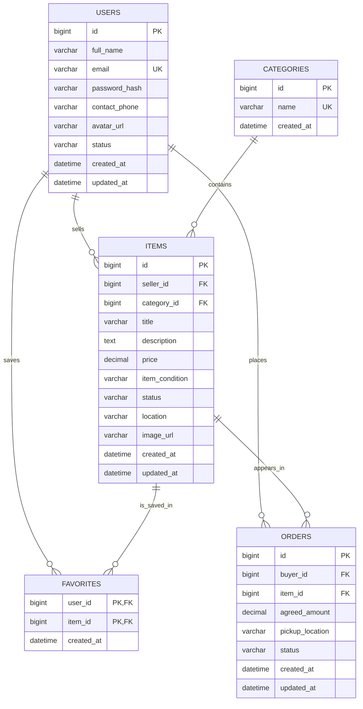

# CampusSwap ER diagram

## Conceptual model

The relational schema contains five tables. At the conceptual level it has four independent entities - `USERS`, `CATEGORIES`, `ITEMS` and `ORDERS` - plus the associative entity `FAVORITES`. `FAVORITES` resolves the many-to-many relationship between users and items and records when each item was saved.

## Relationship mapping

- `USERS` to `ITEMS`: one user can sell zero or many items; every item has exactly one seller through `items.seller_id`.
- `CATEGORIES` to `ITEMS`: one category can contain zero or many items; every item belongs to exactly one category through `items.category_id`.
- `USERS` to `FAVORITES`: one user can save zero or many items.
- `ITEMS` to `FAVORITES`: one item can be saved by zero or many users.
- `FAVORITES` uses the composite primary key `(user_id, item_id)`, so the same user cannot save the same item twice.
- `USERS` to `ORDERS`: one user can place zero or many orders as a buyer; every order has exactly one buyer through `orders.buyer_id`.
- `ITEMS` to `ORDERS`: one item can appear in zero or many historical orders; every order refers to exactly one item through `orders.item_id`.

## Order cardinality

An item can have multiple historical orders because cancelled orders are retained. The database deliberately does not put a `UNIQUE` constraint on `orders.item_id`.

The backend enforces the separate business rule that an item can have at most one active order whose status is `pending` or `confirmed`. It also coordinates the item status and order status inside transactions:

| Action | Order status | Item status |
| --- | --- | --- |
| Buyer places an order | new `pending` | `available` to `reserved` |
| Seller confirms | `pending` to `confirmed` | remains `reserved` |
| Buyer or seller cancels | `pending` or `confirmed` to `cancelled` | `reserved` to `available` |
| Seller completes handover | `confirmed` to `completed` | `reserved` to `sold` |

Completed and cancelled orders are terminal. Concurrent buyers are prevented from creating two active orders for the same item by locking the item row and checking its status in a transaction.

## Deletion and history

Order history must remain understandable after a listing changes, so `agreed_amount` and `pickup_location` are stored as order snapshots.

Foreign keys prevent hard deletion of items or users that are still referenced. The backend allows deletion only when an item has no order history. For such an unused item, it deletes the item's favorites and the item together in one transaction.

## Normalization summary

User and category data are stored once in their respective tables. The many-to-many favorite relationship is separated into `FAVORITES`, while order snapshots preserve transaction-time values independently of later item edits.
