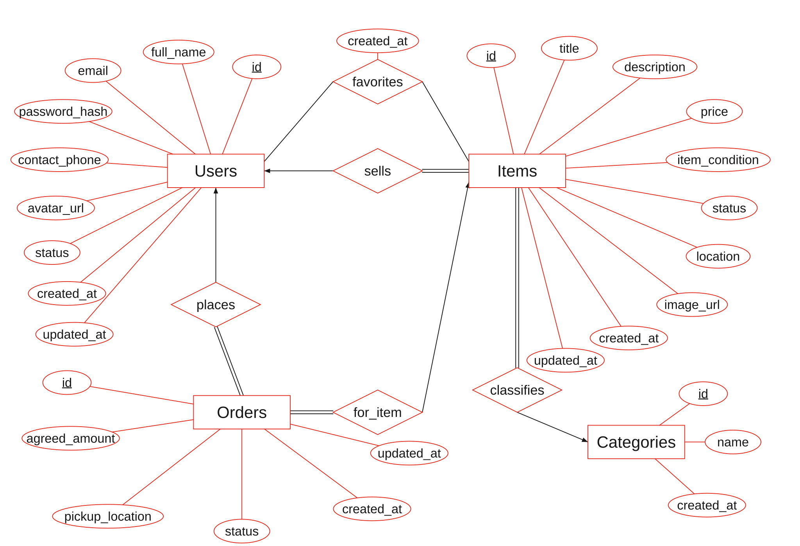

# CampusSwap E-R diagram — classroom notation



[Open the vector SVG](diagrams/campusswap-chen.svg) · [PNG for slides](diagrams/campusswap-chen.png) · [Editable Python source](../scripts/render_er_diagram.py)

## Layout revision

The diagram now uses 40-pixel bold attribute text, 44-pixel bold and underlined primary keys, and 46-pixel bold entity text (originally 24-pixel attributes and 32-pixel entities), on a tighter 2150 x 1470 canvas (previously 3000 x 2300). Entity groups sit closer together, connectors use direct routes, SVG strokes have rounded caps/joins, and the PNG is rendered at 3x resolution before anti-aliased downsampling. The image contains only entity, relationship and attribute labels, with the required ER symbols. Title, legend and explanatory prose are intentionally outside the image.

The current revision branch is `improve-er-diagram-layout`. The earlier `docs/chen-er-diagram` name meant documentation using Chen ER notation; it was not a teammate name.

## Reference and design approach

The notation follows **COMP3278 Assignment 1, Question 1** and the supplied **Suggested Answer — Question 1** (solution PDF page 1): red entity/relationship/attribute outlines, black relationship lines, white background, underlined keys, arrows toward the one side, and double lines for total participation. The supplied PDFs are classroom references and are not redistributed in this repository.

This adapts the answer's notation to CampusSwap's implemented schema; it does not copy Instagram entities or fabricate specialization/weak entities. The assignment's fixed entity positions apply to its supplied answer sheet, not to this different application. The answer's pink circles are teaching annotations, not an additional ER symbol, so they are omitted here.

The diagram is a **conceptual ER model**, not a list of SQL tables with crow's-foot connectors. It contains **four entity sets** (Users, Items, Categories, Orders) and **five relationship sets** (sells, favorites, places, for_item, classifies). Mapping this model yields the **five tables** in `sql/schema.sql`.

## How to read it

| Symbol | Meaning in this diagram |
|---|---|
| Rectangle | Entity set |
| Diamond | Relationship set |
| Ellipse | Attribute |
| Solid underline | Selected primary-key attribute |
| Arrow from relationship toward an entity | At most one entity on that side |
| Double relationship line | Total participation: every entity on that side participates |
| Single relationship line | Partial participation, unless further business rules restrict it |

Attribute connector lines do not encode participation. Items' total participation in sells and the arrow to Users together mean each item has exactly one seller. Users' partial participation permits a user with no listings. Explanations and cardinality prose are kept here rather than inside the image.

## Cardinalities and participation

| Relationship | Mapping | Participation and explanation | SQL mapping |
|---|---|---|---|
| Users — sells — Items | 1:N | User partial; Item total. Every item has one seller; a user can sell zero/many items. | `items.seller_id NOT NULL` → `users.id` |
| Categories — classifies — Items | 1:N | Category partial; Item total. Every item has one category; a category can be empty. | `items.category_id NOT NULL` → `categories.id` |
| Users — places — Orders | 1:N | User partial; Order total. Every order has one buyer; a user can have no orders. | `orders.buyer_id NOT NULL` → `users.id` |
| Items — for_item — Orders | 1:N | Item partial; Order total. Every order concerns exactly one item; an item can have zero/many historical orders. | `orders.item_id NOT NULL` → `items.id`; no lifetime uniqueness |
| Users — favorites — Items | M:N | Both partial. A user can save zero/many items; an item can be saved by zero/many users. | `favorites(user_id, item_id, created_at)`; composite PK `(user_id,item_id)` |

The same Users entity participates in sells and places with different roles, seller and buyer. They are not disjoint subclasses: one account can do both.

## Why favorites is a diamond

The reference answer represents Users liking Posts using a **like relationship with a like_time attribute**. CampusSwap favorites has the same structure: Users favorite Items, and `created_at` belongs to that relationship.

Reducing this M:N relationship creates the SQL `favorites` table. Both participating keys form its composite primary key. The table's existence does not require a fifth strong entity rectangle. All four strong entities already have independent global IDs, so none is a weak entity; Orders is not weak merely because it references an item.

## Attribute coverage and exact schema correspondence

Labels use the actual SQL names; each underlined `id` belongs to its own entity. No new attributes or columns are proposed.

| Conceptual owner | Attributes drawn as ellipses |
|---|---|
| Users | id, full_name, email, password_hash, contact_phone, avatar_url, status, created_at, updated_at |
| Items | id, title, description, price, item_condition, status, location, image_url, created_at, updated_at |
| Orders | id, agreed_amount, pickup_location, status, created_at, updated_at |
| Categories | id, name, created_at |
| favorites relationship | created_at |

All **35 schema columns** are accounted for: 29 entity/relationship attributes and six relationship-key columns (`items.seller_id`, `items.category_id`, `orders.buyer_id`, `orders.item_id`, `favorites.user_id`, `favorites.item_id`). The six latter columns appear when the conceptual relationships are reduced to tables; duplicating them as conceptual foreign-key ellipses would obscure that distinction.

`users.email` and `categories.name` have additional UNIQUE constraints in the SQL schema. They are not underlined as selected primary keys in this figure. Nullable attributes such as image_url remain ordinary ellipses; single/double relationship lines do not indicate column nullability.

## Order history and limits of the drawing

The old diagram's `0..1` lifetime order rule was incompatible with the implementation and with retaining cancelled orders. Item 104 in the seed has a cancelled order and a later pending order. It must therefore permit multiple historical orders.

The separate rule **at most one active order per item** applies only to pending/confirmed orders. It is not represented by an unconditional 1:1 relationship and is not enforced by the current DDL. Backend code still needs to implement and test it. Likewise, buyer ≠ seller, valid state transitions and authorization are business rules beyond these ordinary cardinalities.

The snapshots `agreed_amount` and `pickup_location` belong to Orders and are stored facts, not derived attributes. An item with any order history cannot be hard-deleted under the current foreign keys. An unused item can be physically deleted after its favorites are handled. This diagram changes no SQL or application behaviour.

## Rebuild from code

From the repository root, using Python 3.9+:

```sh
python scripts/render_er_diagram.py
```

This regenerates the SVG using only Python's standard library. The script uses fixed coordinates for a stable, editable layout and explicitly draws the classroom arrow/double-line notation. Edit the labels/coordinates in the source, then regenerate; do not manually edit the generated SVG.

To also regenerate the committed PNG:

```sh
python -m pip install Pillow
python scripts/render_er_diagram.py --png
```

PNG rendering uses Arial Bold on Windows or DejaVu Sans Bold on Linux; install one of those fonts if needed. SVG remains usable without either installed locally (the viewer supplies a sans-serif fallback). The committed SVG/PNG are ready to view without running the script. No PDF renderer, Graphviz, Mermaid extension, browser, or external image service is required.

## Checks and presentation use

- Visually inspected the full rendered PNG and corrected overlapping ellipses/labels.
- Verified four entity rectangles, five relationship diamonds, 29 attribute ellipses and four bold, underlined primary keys.
- Verified all 35 columns in `sql/schema.sql` are accounted for by attributes or relationship mappings.
- Verified relationships agree with NOT NULL foreign keys and the existing seed's order history.
- Database SQL and its 37-check test suite are unchanged by this documentation branch.

For slides, show the full diagram first and zoom into sells/favorites and then Orders. Explain the arrow and double line using sells, explain the favorites relationship-to-table mapping, then state that an item can have multiple historical orders. Avoid reading every audit/profile attribute aloud.
