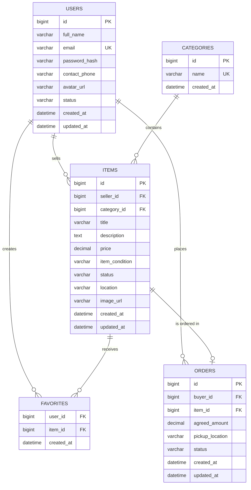

# CampusSwap ER diagram

The MVP uses six entities. A user may sell many items, buy many items, and favorite many items. A category groups many items. Each item may have zero or one order because the MVP treats each listing as a single physical item.

## Relationship explanation

- `USERS` to `ITEMS`: one user can publish many items; every item has exactly one seller.
- `CATEGORIES` to `ITEMS`: one category can contain many items; every item has one category.
- `USERS` to `ITEMS` through `FAVORITES`: this is a many-to-many relationship resolved by the junction table. The composite primary key prevents duplicate favorites.
- `USERS` to `ORDERS`: one user can place many orders; every order has one buyer.
- `ITEMS` to `ORDERS`: an item can have zero or one order. A unique constraint on `orders.item_id` enforces the single-item rule.

## Why the model is normalized

Seller and buyer data are stored once in `USERS`, category names are stored once in `CATEGORIES`, and many-to-many favorites are separated into `FAVORITES`. The order keeps transaction-time values such as `agreed_amount` and `pickup_location`, so later listing edits do not rewrite the transaction record.
